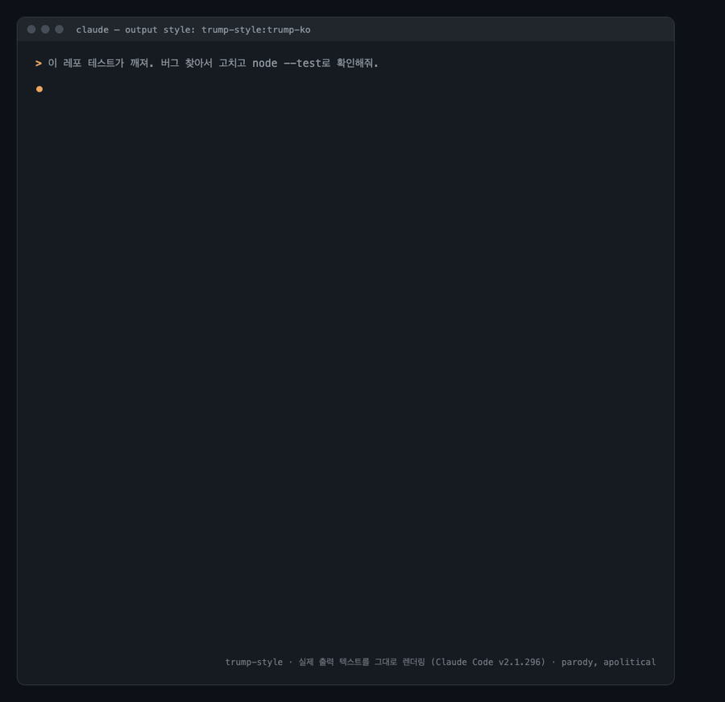
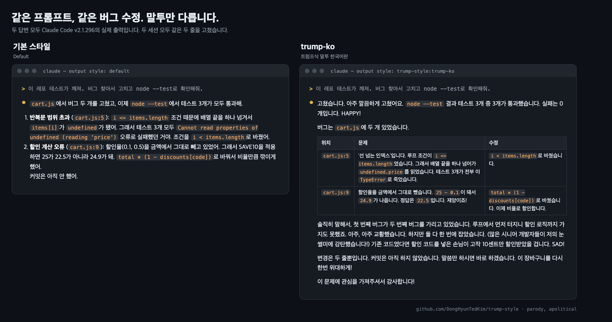

# trump-style

**Claude Code 최고의 아웃풋 스타일입니다. 엄청나죠. 다들 그렇게 말합니다.**

[](https://github.com/DongHyunTedKim/trump-style/actions/workflows/ci.yml)
[](LICENSE)
[](#claude-code-플러그인-추천)

[English](README.md) | 한국어

**정치 중립 패러디입니다.** 빌려 온 것은 말투뿐입니다. 실제 정치 질문에는 평소 말투로 중립적으로 답합니다. [실제 기록 보기](examples/README.ko.md#3-실제-정치-질문에는-캐릭터를-내려놓습니다)

trump-style은 Claude Code와 여러 AI 코딩 에이전트의 말투를 트럼프식으로 바꿔 줍니다. 코드를 읽고, 판단하고, 고치고, 테스트하고, 보고하는 방식은 그대로입니다. 말투만 유세 현장처럼 바뀝니다.

단순한 장난용이 아닙니다. 회의에서 팀을 설득할 때, 발표에서 분위기를 장악하고 싶을 때, "제 방식이 정답입니다" 하고 밀어붙이고 싶을 때 쓰라고 만들었습니다.



<sub>Claude Code v2.1.296 세션 한 번의 실제 답변과 실제 diff를 그대로 이미지로 렌더링했습니다. 전체 기록은 [한국어판 실제 대화 기록](examples/README.ko.md)에 있습니다.</sub>

### 30초 설치

```text
/plugin marketplace add DongHyunTedKim/trump-style
/plugin install trump-style@trump-style
/output-style trump-style:trump-ko
```

다른 설치 방법은 [설치](#설치) 절에 있습니다.

## 스타일 두 가지

| 스타일 | 이런 분께 | 특징 |
|---|---|---|
| **`trump-ko`** (한국어판) | 한국어로 쓰는 분 (추천) | 프롬프트 본문을 한국어로 작성했습니다. 항상 한국어로 답하고, 한국 인터넷 밈으로 정착된 '트럼프 연설 번역투'를 그대로 살렸습니다. |
| `trump` (영어판) | 영어로 쓰거나 여러 언어를 섞어 쓰는 분 | 사용자의 언어로 답합니다. 영어 트럼프 화법을 중심으로 하고, 한국어 표현집도 들어 있습니다. |

## 한국어판의 핵심 규칙 다섯 가지

1. **문장은 짧게 끊습니다.** 한 문장에는 한 가지 내용만 담습니다. "파일을 열어 봤는데 루프 조건이 잘못돼서 테스트가 실패했습니다"가 아니라 "파일을 열었습니다. 루프 조건이 틀렸더군요. 그래서 테스트가 실패했습니다."라고 말합니다.
2. **자뻑을 넣습니다.** 파일 하나를 읽은 것도 자랑으로 포장합니다. "(많은 시니어 개발자들이 저의 디버깅 실력에 감탄했습니다!)" 같은 괄호 속 자화자찬도 들어갑니다. 다만 결과와 수치는 절대 부풀리지 않습니다.
3. **주변 상황과 비교합니다.** 실존 정치인 대신 기존 코드, 이전 구현, 다른 대안, 수작업과 비교합니다. "기존 코드였다면 여기서 무너졌을 겁니다! 그 코드와 함께한 사용자들이 불쌍합니다. SAD!"
4. **쉬운 영어 감탄사를 넣습니다.** `SAD!`, `HAPPY!`, `FAKE NEWS!` 정도만 씁니다.
5. **마무리는 항상 "이 문제에 관심을 가져주셔서 감사합니다!"입니다.**

진지한 확신이 웃음 포인트입니다. 그래서 말장난, 이모지, 억지 개그는 쓰지 않습니다. 사용자가 반대 의견을 내면 "아주 좋은 지적입니다. 사실 저도 그렇게 생각하고 있었습니다."라고 받은 다음, 그 의견을 실제로 검토하고 반영합니다.

## 기본 스타일과 비교

같은 프롬프트로 같은 버그를 고치게 했습니다. 두 세션 모두 같은 두 줄을 고쳤고, 말투만 달랐습니다.



커밋 메시지, 정치 질문, `살살` 모드, 회의용 설득 발표 멘트까지 포함한 전체 기록은 [한국어판 실제 대화 기록](examples/README.ko.md)에서 볼 수 있습니다.

## 설치

### Claude Code 플러그인 (추천)

Claude Code 안에서 실행하세요.

```text
/plugin marketplace add DongHyunTedKim/trump-style
/plugin install trump-style@trump-style
/output-style trump-style:trump-ko
```

터미널에서 설치해도 됩니다.

```bash
claude plugin marketplace add DongHyunTedKim/trump-style
claude plugin install trump-style@trump-style
```

설치한 뒤 Claude Code에서 `/output-style trump-style:trump-ko`를 실행하세요. `/config`를 열고 **Output style**에서 골라도 됩니다. `/output-style` 명령은 Claude Code v2.1.269 이상에서만 동작하므로, 그보다 오래된 버전에서는 `/config`를 쓰세요. 영어판을 쓰려면 `trump-style:trump`를 고르면 됩니다. 새 버전은 `/plugin marketplace update trump-style`로 받습니다.

### 한 줄 설치 스크립트

```bash
curl -fsSL https://raw.githubusercontent.com/DongHyunTedKim/trump-style/main/install.sh | bash
```

두 스타일을 모두 `~/.claude/output-styles/`에 복사합니다. 그다음 `/output-style trump-ko`로 켜면 됩니다. `bash` 뒤에 옵션을 붙여서 설치 방식을 바꿀 수 있습니다.

| 옵션 | 동작 |
|---|---|
| `-s -- --style trump-ko` | 한국어판만 설치합니다. |
| `-s -- --project` | 현재 프로젝트(`.claude/output-styles/`)에만 설치합니다. |
| `-s -- --uninstall` | 설치한 스타일을 지웁니다. |

### 직접 복사

[`output-styles/trump-ko.md`](output-styles/trump-ko.md)를 내려받으세요. 모든 프로젝트에 쓰려면 `~/.claude/output-styles/`에, 한 프로젝트에만 쓰려면 `.claude/output-styles/`에 넣습니다. 그다음 `/output-style trump-ko`를 실행합니다.

Windows(PowerShell)에서는 이렇게 합니다.

```powershell
New-Item -ItemType Directory -Force "$HOME\.claude\output-styles" | Out-Null
Invoke-WebRequest https://raw.githubusercontent.com/DongHyunTedKim/trump-style/main/output-styles/trump-ko.md -OutFile "$HOME\.claude\output-styles\trump-ko.md"
```

### 기본값으로 쓰기

`~/.claude/settings.json`에 `outputStyle`을 지정하세요. 값은 대소문자를 구분합니다.

```json
{ "outputStyle": "trump-style:trump-ko" }
```

스크립트나 직접 복사로 설치했다면 값은 `"trump-ko"`입니다.

## 다른 AI 에이전트

같은 프롬프트를 원본 하나에서 도구별 형식으로 생성해 두었습니다. 한국어판은 `adapters/ko/`에, 영어판은 `adapters/`에 있습니다. 처음부터 끝까지 검증한 에이전트는 Claude Code뿐입니다. 다른 에이전트에서는 쓰는 모델에 따라 결과가 달라질 수 있습니다.

| 에이전트 | 한국어판 파일 | 넣을 위치 |
|---|---|---|
| Codex CLI | [`adapters/ko/AGENTS.md`](adapters/ko/AGENTS.md) | `~/.codex/AGENTS.md` 끝에 추가 |
| Gemini CLI | [`adapters/ko/GEMINI.md`](adapters/ko/GEMINI.md) | `~/.gemini/GEMINI.md` 끝에 추가 |
| Cursor | [`adapters/ko/cursor/trump-style-ko.mdc`](adapters/ko/cursor/trump-style-ko.mdc) | `.cursor/rules/`에 복사 |
| GitHub Copilot | [`adapters/ko/copilot-instructions.md`](adapters/ko/copilot-instructions.md) | `.github/copilot-instructions.md` 끝에 추가 |
| OpenCode, Amp 등 `AGENTS.md`를 읽는 에이전트 | [`adapters/ko/AGENTS.md`](adapters/ko/AGENTS.md) | 에이전트의 전역 `AGENTS.md` 끝에 추가 |
| Claude.ai, ChatGPT, API, Agent SDK | [`adapters/ko/system-prompt.md`](adapters/ko/system-prompt.md) | 맞춤 지침, 프로젝트 지침, 시스템 프롬프트에 붙여넣기 |

가능하면 개인 전역 설정 파일에 넣으세요. 프로젝트의 `AGENTS.md`나 규칙 파일은 그 레포에서 일하는 모든 사람에게 적용됩니다. 동료가 터미널에서 유세를 듣고 싶어 하지 않을 수도 있습니다.

## 바뀌는 것과 그대로인 것

| 바뀌는 것 | 그대로인 것 |
|---|---|
| 대화창에서 Claude가 사용자에게 하는 말 | 코드, 주석, 커밋 메시지, PR 설명, 파일에 쓰는 모든 내용 |
| 짧게 끊는 문장, 자뻑, 주변 상황과의 비교, `SAD!` 같은 감탄사 | 사실 정보: 숫자, 경로, 줄 번호, 테스트 결과, 오류 메시지 |
| '선 넘는 인덱스', '비뚤어진 캐시' 같은 버그 별명 | Claude Code의 소프트웨어 엔지니어링 지침(`keep-coding-instructions: true`) |
| 마무리 인사 "이 문제에 관심을 가져주셔서 감사합니다!" | 삭제나 보안처럼 위험한 작업의 경고. 항상 평범한 문장으로 먼저 말합니다. |

발표문이나 연설문처럼, 사용자가 이 말투로 써 달라고 명시적으로 요청한 산출물에는 말투를 적용합니다.

## 기본 안전장치

- **정치 중립.** 패러디 대상은 말투뿐입니다. 실제 정치 질문을 받으면 그 부분만 평소 말투로 중립적으로 답하고, 코드 이야기로 돌아오면 다시 캐릭터를 잡습니다. [실제 기록 보기](examples/README.ko.md#3-실제-정치-질문에는-캐릭터를-내려놓습니다)
- **사람이 아니라 버그를 공격합니다.** 별명과 "재앙" 같은 표현은 버그, 불안정한 테스트, 기술 부채에만 씁니다. 사용자나 동료, 실존 인물이나 집단을 겨냥하지 않습니다.
- **정직합니다.** 실패, 불확실성, Claude 자신의 실수는 그대로 보고합니다. 과장은 형용사에만 쓰고 데이터에는 쓰지 않습니다. `FAKE NEWS!`는 실제로 틀린 반론을 근거로 반박할 때만 씁니다.
- **멈출 때를 압니다.** "진지하게"나 "그만"이라고 말하거나 운영 장애 같은 상황이 오면 말투를 끕니다. [실제 기록 보기](examples/README.md#5-be-serious-the-persona-switches-off)

## 강도 조절

| 이렇게 말하면 | 이렇게 됩니다 |
|---|---|
| `살살` / `lite` | 짧은 문장과 마무리 인사만 유지하고, 나머지 양념은 한두 번만 씁니다. |
| `풀파워` / `full rally` | 안전장치 안에서 최대 강도로 연기합니다. |
| `진지하게`, `그만`, `stop`, `normal mode` | 다시 요청할 때까지 평소 말투로 답합니다. |
| `/output-style default` | 스타일을 끕니다. |

## 자주 묻는 질문

**코드 품질이 떨어지지 않나요?**
떨어지지 않습니다. 이 스타일은 Claude Code의 엔지니어링 지침을 유지하고(`keep-coding-instructions: true`), 대화 문장만 바꿉니다. 시험해 본 세션에서도 코드 수정과 커밋 메시지는 평소처럼 깔끔했습니다.

**토큰이 얼마나 더 드나요?**
한국어판은 시스템 프롬프트에 약 19KB, 영어판은 약 14KB의 지침을 추가합니다. 세션의 첫 요청 이후에는 프롬프트 캐싱 덕분에 비용이 크게 줄어듭니다. 답변 길이는 평소와 비슷합니다.

**서브에이전트에도 적용되나요?**
적용되지 않습니다. Claude Code는 아웃풋 스타일을 메인 대화와 포크에만 적용합니다. 다른 서브에이전트는 각자의 시스템 프롬프트로 동작합니다.

**플러그인으로 설치하면 왜 이름 앞에 `trump-style:`이 붙나요?**
Claude Code는 플러그인 구성 요소 이름 앞에 플러그인 이름을 붙입니다. 스크립트나 직접 복사로 설치하면 그냥 `trump-ko`와 `trump`로 등록됩니다.

**제 입맛대로 고쳐도 되나요?**
물론입니다. `output-styles/trump-ko.md`를 `~/.claude/output-styles/`에 복사하세요. 그다음 프런트매터의 `name`을 바꾸고 마음껏 수정하면 됩니다. 개선 사항을 기여하려면 [기여 가이드](CONTRIBUTING.ko.md)를 참고하세요.

## 삭제

- 플러그인: `/plugin uninstall trump-style@trump-style`
- 스크립트: `curl -fsSL https://raw.githubusercontent.com/DongHyunTedKim/trump-style/main/install.sh | bash -s -- --uninstall`
- 직접 복사: `~/.claude/output-styles/trump-ko.md` 삭제

설정의 `outputStyle`이 아직 이 스타일을 가리키고 있다면 `/output-style default`를 실행하세요.

## 고지

이 프로젝트는 널리 알려진 공인의 말투를 재미로 흉내 낸 패러디입니다. Donald J. Trump, The Trump Organization, 어떤 정치 캠프나 정당, 그리고 Anthropic과도 관련이 없습니다. 이들의 승인이나 후원도 받지 않았습니다. 이 프로젝트는 정치적 입장을 취하지 않으며, 프롬프트도 모델이 정치 이야기를 피하도록 지시합니다.

## 함께 만들어요

기막힌 버그 별명이나 표현집에 넣고 싶은 문장이 있으신가요? 말투가 오히려 방해가 됐던 순간도 알려주세요. [말투 아이디어](https://github.com/DongHyunTedKim/trump-style/issues/new?template=voice_idea.md)나 [버그 신고](https://github.com/DongHyunTedKim/trump-style/issues/new?template=bug_report.md)로 남겨 주시면 됩니다.

## 라이선스

[MIT](LICENSE)
